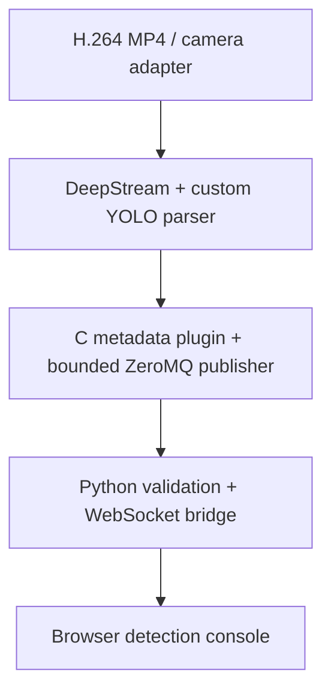

# Jetson Edge Vision

A fresh public reference implementation of an edge computer-vision architecture: YOLO detection on NVIDIA Jetson using DeepStream/GStreamer, C/C++ plugins, TensorRT engine caching, ZeroMQ detection events and a browser dashboard.

**Provenance:** independently recreated in October 2026 from a high-level description of Muhammad Zohaib Jan's experience. This repository contains newly written demonstration code, synthetic events and no previous employer/client source, models or footage. It does not claim the original deployment's performance or outcomes.

## Architecture



The launcher accepts **one H.264 MP4 or one H.264 RTSP stream**. USB/CSI cameras, authenticated camera provisioning, reconnection and multiple streams are extension points. CCTV, roads, warehouses and drone imagery are potential application domains, not validated use cases.

## Build and run

See the **[complete runbook](docs/runbook.md)** for shell scripts, dependency installation, file and RTSP pipelines, generated configs, cache behaviour and troubleshooting. The [example inference config](configs/infer-yolo.ini.example) documents the defaults.

## Try without a Jetson

Requires Python 3.11+. From this repository:

```bash
python -m venv .venv
. .venv/bin/activate
python -m pip install -e '.[test]'
python -m uvicorn edgevision.bridge:app --host 127.0.0.1 --port 8000
# In a second terminal using the same environment:
edge-simulate
```

Open http://127.0.0.1:8000. The console explicitly labels synthetic events. It draws object coordinates on a grid; it does not transmit or display real camera video.

## Native implementation

| Component | Role |
|---|---|
| C++ edgeyolo element | GstBin wrapping NVIDIA nvinfer |
| C++ NvDsInferParseEdgeYolo | Validates/decodes the supported YOLO output |
| C edgeevents element | Reads NvDsBatchMeta and serializes object metadata |
| C++ publisher | Owns its ZeroMQ socket on one worker; bounded queue drops oldest events |
| Python launcher | Hashes model, parser, labels and target fingerprint into a cache directory |
| Python bridge | Validates messages and fans out through bounded per-browser queues |

NVIDIA **nvinfer**, rather than a reimplementation of TensorRT, builds the engine from ONNX when no usable cached engine exists, saves it, then reuses it on subsequent runs.

### Model contract

- ONNX, batch 1, static input, decoded YOLOv8-style output: one FP32 tensor shaped [1, 4+C, N] or [1, N, 4+C].
- Output is center-x, center-y, width, height in network-input pixels, followed by C class probabilities.
- No objectness column, raw anchor head, logits, segmentation masks, rotated boxes or embedded end-to-end NMS. Arbitrary .pt files and every YOLO variant are not supported.
- One label per class. RGB input scaled by 1/255, stretch resize (no letterboxing). DeepStream performs class-wise NMS.
- Exporter, model licensing, preprocessing and tensor names/shapes must be checked for your chosen model. No weights or model download scripts are supplied.

### Target build

SDK adapter target: DeepStream 7.1-style C/C++ APIs on Jetson Orin. Match the SDK, JetPack, CUDA and TensorRT versions using NVIDIA's support matrix. Older Xavier/Nano stacks may need adaptation. The bridge can run on another machine; the launcher requires Python 3.11+.

Install the DeepStream development SDK and its documented prerequisites, plus CMake, a C/C++ compiler, pkg-config, GStreamer development headers, libzmq3-dev and libjson-glib-dev. Then:

```bash
cmake -S . -B build -DBUILD_DEEPSTREAM=ON \
  -DDEEPSTREAM_ROOT=/opt/nvidia/deepstream/deepstream
cmake --build build -j2
export GST_PLUGIN_PATH="$PWD/build"
gst-inspect-1.0 edgeyolo
gst-inspect-1.0 edgeevents
edge-vision --model /absolute/path/model.onnx --labels /absolute/path/labels.txt \
  --input /absolute/path/test-h264.mp4
```

First-run compilation may take minutes. Engines are target/runtime specific. The cache key includes model/parser/label bytes, precision, dimensions, the installed inference-library hash, package details and a hashed local machine identifier. Do not copy plans between devices or stacks. Remove a suspect cache entry and rebuild; never deserialize an untrusted engine.

## Verification

```bash
cmake -S . -B build -DCMAKE_BUILD_TYPE=Debug
cmake --build build
ctest --test-dir build --output-on-failure
python -m pytest -q
```

Portable [CI](https://github.com/zohaibjan/jetson-edge-vision/actions/workflows/tests.yml) runs the C++ decoder, the real C++ ZeroMQ publisher over TCP, Python TCP/in-process transport and WebSocket integration, command/config generation, GStreamer core parsing of special paths, ShellCheck and shell syntax checks. These tests do not exercise NVIDIA inference.

DeepStream/CUDA adapters and TensorRT engine generation have **not been compiled or executed on Jetson**. No real MP4/RTSP inference or FPS, latency or accuracy benchmark is claimed.

See [target validation](docs/target-validation.md), [architecture decisions](docs/architecture.md) and [security](SECURITY.md).

## Primary references

- [NVIDIA custom models](https://docs.nvidia.com/metropolis/deepstream/dev-guide/text/DS_using_custom_model.html)
- [NVIDIA nvinfer](https://docs.nvidia.com/metropolis/deepstream/dev-guide/text/DS_plugin_gst-nvinfer.html)
- [NVIDIA custom GStreamer plugins](https://docs.nvidia.com/metropolis/deepstream/7.1/text/DS_sample_custom_gstream.html)
- [ZeroMQ](https://zeromq.org/get-started/) · [PyZMQ asyncio](https://pyzmq.readthedocs.io/en/latest/api/zmq.asyncio.html)
